# Quizlo Backend API MySQL Data Flows

This document details the MySQL database table relationships for all API endpoints in the Quizlo system. It details which tables are **Read** (connected to return API data) and which are **Created / Updated / Deleted** (affected in save, update, or deletion operations).

---

## 1. Authentication Module

### Send OTP
* **Endpoint**: `POST /auth/send-otp`
* **Data Flow**:
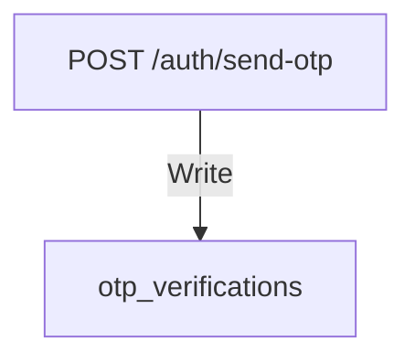

### Verify OTP
* **Endpoint**: `POST /auth/verify-otp`
* **Data Flow**:
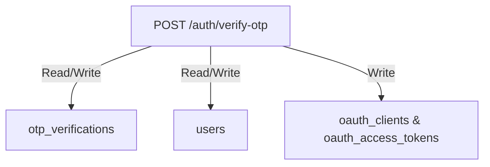

### Register User
* **Endpoint**: `POST /auth/register`
* **Data Flow**:
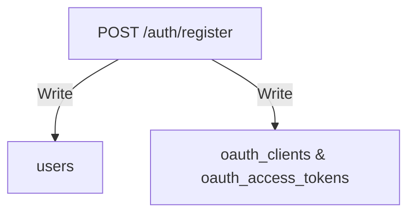

### Login & Admin Login
* **Endpoints**: `POST /auth/login` / `POST /auth/admin-login`
* **Data Flow**:
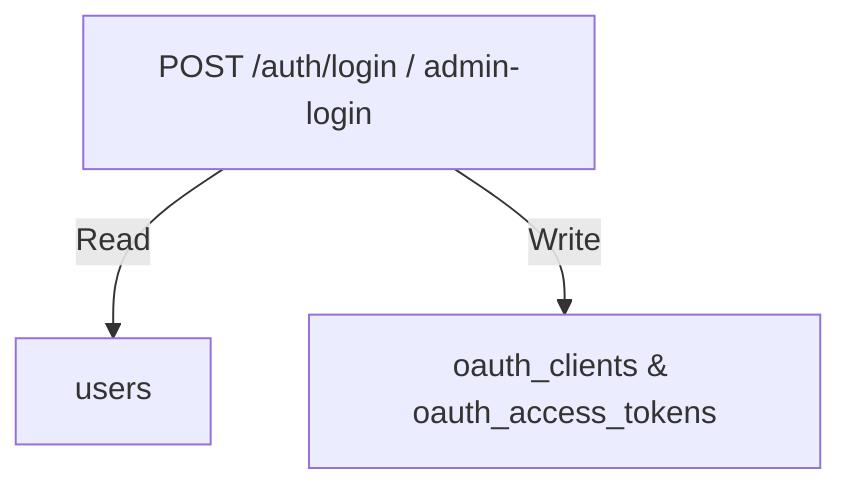

### Refresh Token
* **Endpoint**: `POST /auth/refresh-token`
* **Data Flow**:
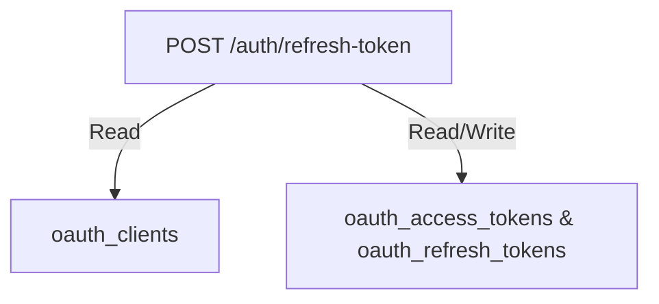

### Send Verification OTP
* **Endpoint**: `POST /auth/send-verification`
* **Data Flow**:
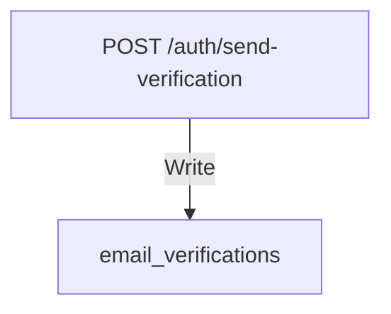

### Verify Email OTP & Web Link
* **Endpoints**: `POST /auth/verification` / `GET /auth/verification-link`
* **Data Flow**:
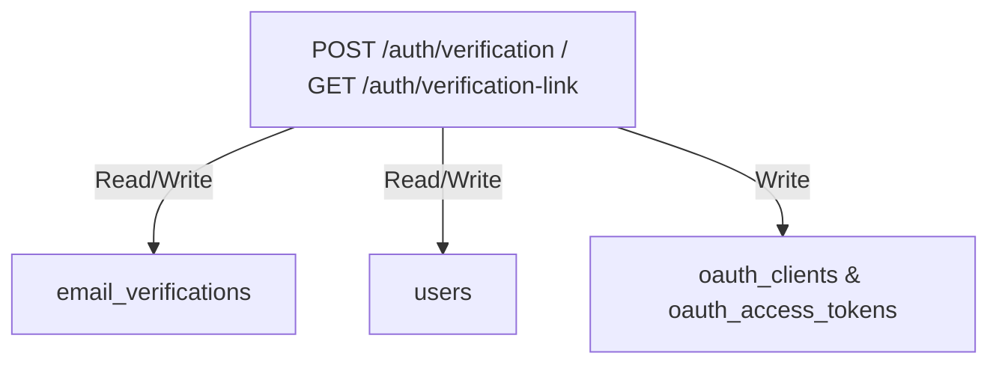

### Send Forget Password OTP
* **Endpoint**: `POST /auth/send-forget-password-otp`
* **Data Flow**:
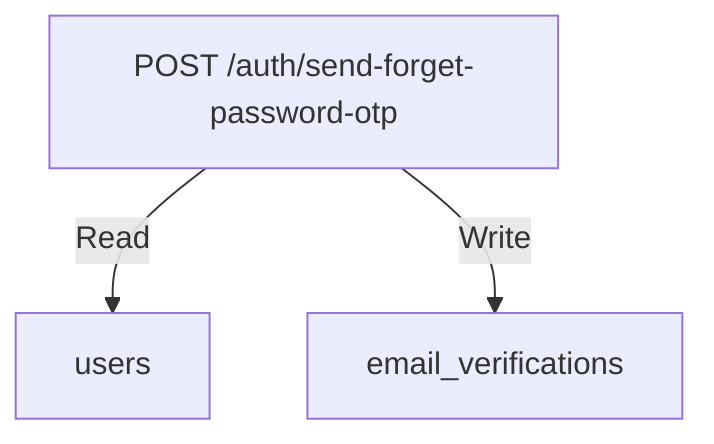

### Update Password
* **Endpoint**: `POST /auth/update-password`
* **Data Flow**:
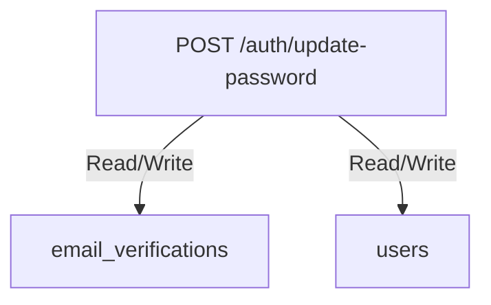

### Change Password
* **Endpoint**: `POST /auth/change-password`
* **Data Flow**:
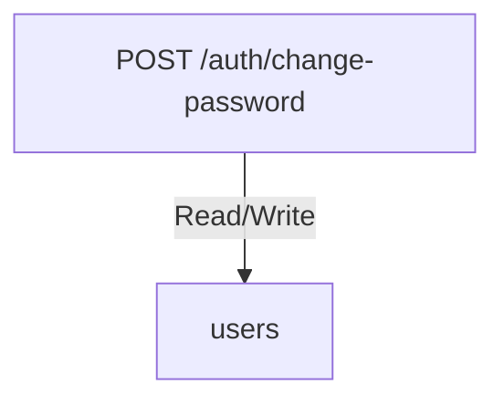

### Google OAuth / Exchange
* **Endpoints**: `POST /auth/google/exchange` / `GET /auth/google` / `GET /auth/google/callback`
* **Data Flow**:
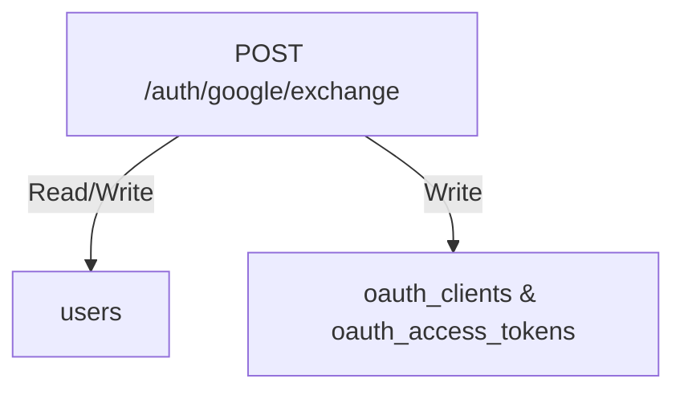

---

## 2. Exam Type & User Profile Modules

### Get Exam Types
* **Endpoint**: `GET /exam-types`
* **Data Flow**:
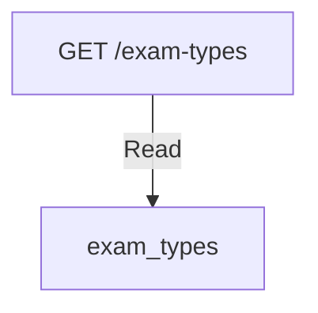

### Get User Profile
* **Endpoint**: `GET /user/profile`
* **Data Flow**:
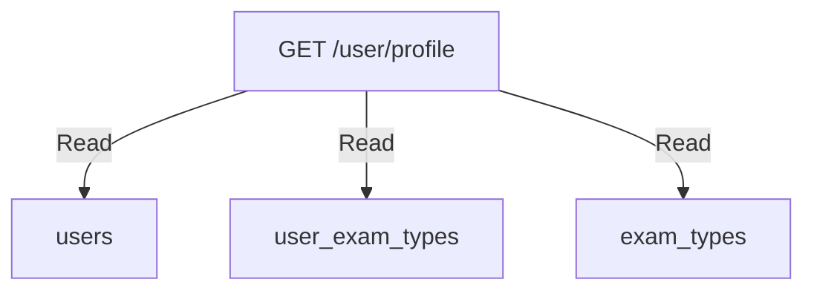

### Update User Profile
* **Endpoint**: `PUT /user/profile`
* **Data Flow**:
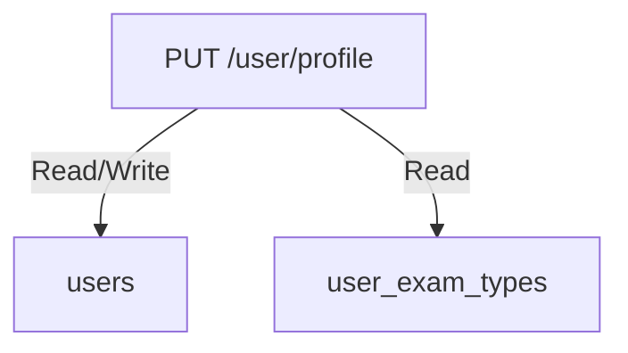

### Set Daily Goal
* **Endpoint**: `PUT /user/daily-goal`
* **Data Flow**:
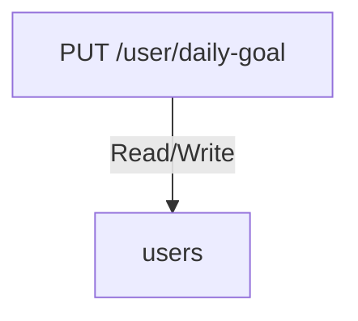

### Enroll in Exam Type
* **Endpoint**: `POST /user/exam-types`
* **Data Flow**:
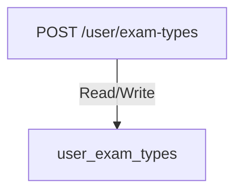

### Disenroll from Exam Type
* **Endpoint**: `DELETE /user/exam-types/id`
* **Data Flow**:
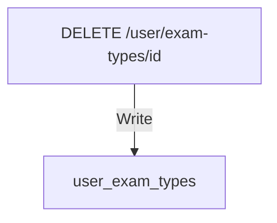

### Set Primary Exam Type
* **Endpoint**: `PATCH /user/exam-types/id/set-primary`
* **Data Flow**:
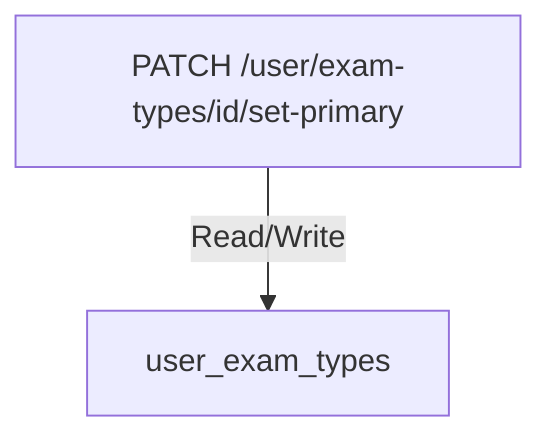

---

## 3. Content, Learning, & Question Answering Modules

### Get Subjects
* **Endpoint**: `GET /subjects`
* **Data Flow**:
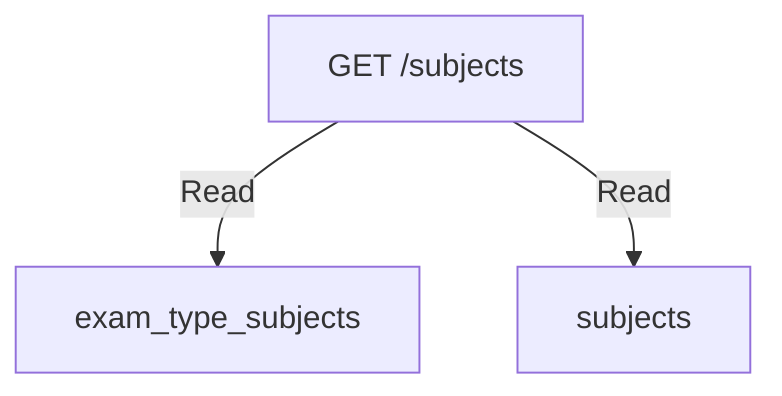

### Get Lessons
* **Endpoint**: `GET /subjects/id/lessons`
* **Data Flow**:
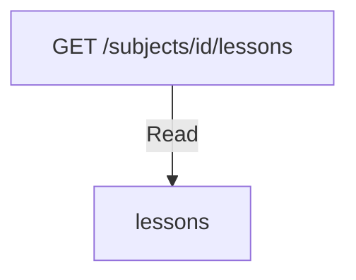

### Get Questions
* **Endpoint**: `GET /lessons/id/questions`
* **Data Flow**:
```mermaid
graph TD
    API["GET /lessons/id/questions"] -->|Read| T1["questions"]
    API -->|Read| T2["question_options"]
    API -->|Read| T3["users"]
```

### Complete Lesson
* **Endpoint**: `POST /lessons/id/complete`
* **Data Flow**:
```mermaid
graph TD
    API["POST /lessons/id/complete"] -->|Read| T1["lessons"]
    API -->|Write| T2["user_lesson_completions"]
    API -->|Read/Write| T3["user_coins"]
    API -->|Write| T4["coin_transactions"]
```

### Submit Answer
* **Endpoint**: `POST /questions/answer`
* **Data Flow**:
```mermaid
graph TD
    API["POST /questions/answer"] -->|Read| T1["user_hearts (Heart Check)"]
    API -->|Read| T2["questions"]
    API -->|Read| T3["question_options"]
    API -->|Write| T4["user_answers"]
    API -->|Read/Write| L1["user_xps (AwardXpOnAnswer)"]
    API -->|Write| L2["xp_transactions (AwardXpOnAnswer)"]
    API -->|Read/Write| L3["user_hearts (DeductHeartOnWrongAnswer)"]
    API -->|Read/Write| L4["user_streaks (UpdateStreakOnAnswer)"]
    API -->|Read/Write| L5["user_daily_progress (UpdateDailyProgress)"]
    API -->|Read/Write| L6["user_leagues (UpdateLeagueXp)"]
    API -->|Read/Write| L7["user_subject_masteries (UpdateSubjectMastery)"]
```

---

## 4. Gamification Module

### Get Gamification Dashboard
* **Endpoint**: `GET /gamification/dashboard`
* **Data Flow**:
```mermaid
graph TD
    API["GET /gamification/dashboard"] -->|Read| T1["user_xps"]
    API -->|Read| T2["user_streaks"]
    API -->|Read| T3["user_hearts"]
    API -->|Read| T4["user_coins"]
    API -->|Read| T5["user_daily_progress"]
```

### Streak Freeze
* **Endpoints**: `GET /gamification/streak` / `POST /gamification/streak/freeze`
* **Data Flow**:
```mermaid
graph TD
    API1["GET /gamification/streak"] -->|Read| T1["user_streaks"]
    API2["POST /gamification/streak/freeze"] -->|Read/Write| T2["user_streaks"]
```

### Heart & Refill
* **Endpoints**: `GET /gamification/hearts` / `POST /gamification/hearts/refill`
* **Data Flow**:
```mermaid
graph TD
    API1["GET /gamification/hearts"] -->|Read| T1["user_hearts"]
    API2["POST /gamification/hearts/refill"] -->|Read/Write| T2["user_coins"]
    API2 -->|Read/Write| T3["user_hearts"]
    API2 -->|Write| T4["coin_transactions"]
```

### Coins & Spend
* **Endpoints**: `GET /gamification/coins` / `POST /gamification/coins/spend`
* **Data Flow**:
```mermaid
graph TD
    API1["GET /gamification/coins"] -->|Read| T1["user_coins"]
    API2["POST /gamification/coins/spend"] -->|Read/Write| T2["user_coins"]
    API2 -->|Write| T3["coin_transactions"]
```

### Achievements
* **Endpoints**: `GET /achievements` / `GET /achievements/earned`
* **Data Flow**:
```mermaid
graph TD
    API1["GET /achievements"] -->|Read| T1["achievements"]
    API2["GET /achievements/earned"] -->|Read| T2["user_achievements"]
    API2 -->|Read| T3["achievements"]
```

### Progress Stats
* **Endpoints**: `GET /progress/subjects` / `GET /progress/daily` / `GET /progress/personal-best`
* **Data Flow**:
```mermaid
graph TD
    API1["GET /progress/subjects"] -->|Read| T1["user_subject_masteries"]
    API2["GET /progress/daily"] -->|Read| T2["user_daily_progress"]
    API3["GET /progress/personal-best"] -->|Read| T3["user_daily_progress"]
```

---

## 5. League, Model Tests, & Exam Session Modules

### Get Standings
* **Endpoints**: `GET /league/current` / `GET /league/history`
* **Data Flow**:
```mermaid
graph TD
    API1["GET /league/current"] -->|Read| T1["league_seasons"]
    API1 -->|Read| T2["user_leagues"]
    API1 -->|Read| T3["users"]
    API2["GET /league/history"] -->|Read| T4["user_leagues"]
```

### Model Tests List & Countdown
* **Endpoints**: `GET /model-tests` / `GET /exam-countdown`
* **Data Flow**:
```mermaid
graph TD
    API1["GET /model-tests"] -->|Read| T1["model_tests"]
    API2["GET /exam-countdown"] -->|Read| T2["exam_schedules"]
```

### Start Session
* **Endpoint**: `POST /model-tests/id/start`
* **Data Flow**:
```mermaid
graph TD
    API["POST /model-tests/id/start"] -->|Read| T1["model_tests"]
    API -->|Write| T2["exam_sessions"]
```

### Submit Session
* **Endpoint**: `POST /exam-sessions/id/submit`
* **Data Flow**:
```mermaid
graph TD
    API["POST /exam-sessions/id/submit"] -->|Read/Write| T1["exam_sessions"]
    API -->|Read| T2["questions"]
    API -->|Read| T3["question_options"]
    API -->|Write| T4["user_answers"]
    API -->|Read/Write| T5["user_xps"]
    API -->|Write| T6["xp_transactions"]
```

### Get Result
* **Endpoint**: `GET /exam-sessions/id/result`
* **Data Flow**:
```mermaid
graph TD
    API["GET /exam-sessions/id/result"] -->|Read| T1["exam_sessions"]
    API -->|Read| T2["model_tests"]
    API -->|Read| T3["user_answers"]
```

---

## 6. Admin Management Subsystem

### Admin Dashboard Analytics
* **Endpoints**: `GET /admin/dashboard/stats` / `GET /admin/analytics/retention` / `GET /admin/analytics/daily-actives` / `GET /admin/analytics/subject-performance`
* **Data Flow**:
```mermaid
graph TD
    API1["GET /admin/dashboard/stats"] -->|Read| T1["users"]
    API1 -->|Read| T2["questions"]
    API1 -->|Read| T3["exam_sessions"]
    API2["GET /admin/analytics/retention"] -->|Read| T4["users"]
    API2 -->|Read| T5["exam_sessions"]
    API3["GET /admin/analytics/daily-actives"] -->|Read| T6["users"]
    API4["GET /admin/analytics/subject-performance"] -->|Read| T7["user_answers"]
```

### Exam Types Admin CRUD
* **Endpoints**: `GET /admin/exam-types` / `POST /admin/exam-types` / `PUT /admin/exam-types/id`
* **Data Flow**:
```mermaid
graph TD
    API1["GET /admin/exam-types"] -->|Read| T1["exam_types"]
    API2["POST /admin/exam-types"] -->|Write| T2["exam_types"]
    API3["PUT /admin/exam-types/id"] -->|Read/Write| T3["exam_types"]
```

### Subject Assignments
* **Endpoints**: `GET /admin/exam-types/id/subjects` / `POST /admin/exam-types/assign-subject` / `DELETE /admin/exam-types/id/subjects/id`
* **Data Flow**:
```mermaid
graph TD
    API1["GET /admin/exam-types/id/subjects"] -->|Read| T1["exam_type_subjects"]
    API2["POST /admin/exam-types/assign-subject"] -->|Write| T2["exam_type_subjects"]
    API3["DELETE /admin/exam-types/id/subjects/id"] -->|Write| T3["exam_type_subjects"]
```

### Subjects Admin CRUD
* **Endpoints**: `GET /admin/subjects` / `POST /admin/subjects` / `PUT /admin/subjects/id` / `DELETE /admin/subjects/id`
* **Data Flow**:
```mermaid
graph TD
    API1["GET /admin/subjects"] -->|Read| T1["subjects"]
    API2["POST /admin/subjects"] -->|Write| T2["subjects"]
    API3["PUT /admin/subjects/id"] -->|Read/Write| T3["subjects"]
    API4["DELETE /admin/subjects/id"] -->|Write| T4["subjects"]
```

### Exam Type Subjects Admin CRUD
* **Endpoints**: `GET /admin/exam-type-subjects` / `POST /admin/exam-type-subjects` / `PUT /admin/exam-type-subjects/id` / `DELETE /admin/exam-type-subjects/id`
* **Data Flow**:
```mermaid
graph TD
    API1["GET /admin/exam-type-subjects"] -->|Read| T1["exam_type_subjects"]
    API2["POST /admin/exam-type-subjects"] -->|Write| T2["exam_type_subjects"]
    API3["PUT /admin/exam-type-subjects/id"] -->|Read/Write| T3["exam_type_subjects"]
    API4["DELETE /admin/exam-type-subjects/id"] -->|Write| T4["exam_type_subjects"]
```

### Questions Admin CRUD
* **Endpoints**: `GET /admin/questions` / `POST /admin/questions` / `PUT /admin/questions/id` / `DELETE /admin/questions/id`
* **Data Flow**:
```mermaid
graph TD
    API1["GET /admin/questions"] -->|Read| T1["questions"]
    API2["POST /admin/questions"] -->|Write| T2["questions"]
    API2 -->|Write| T3["question_options"]
    API3["PUT /admin/questions/id"] -->|Read/Write| T4["questions"]
    API3 -->|Read/Write| T5["question_options"]
    API4["DELETE /admin/questions/id"] -->|Write| T6["questions"]
    API4 -->|Write| T7["question_options"]
```

### Lessons Admin CRUD
* **Endpoints**: `GET /admin/lessons` / `POST /admin/lessons` / `PUT /admin/lessons/id`
* **Data Flow**:
```mermaid
graph TD
    API1["GET /admin/lessons"] -->|Read| T1["lessons"]
    API2["POST /admin/lessons"] -->|Write| T2["lessons"]
    API3["PUT /admin/lessons/id"] -->|Read/Write| T3["lessons"]
```

### Users & Schedules Admin CRUD
* **Endpoints**: `GET /admin/users` / `PATCH /admin/users/id/toggle-active` / `GET /admin/exam-schedules` / `POST /admin/exam-schedules`
* **Data Flow**:
```mermaid
graph TD
    API1["GET /admin/users"] -->|Read| T1["users"]
    API2["PATCH /admin/users/id/toggle-active"] -->|Read/Write| T2["users"]
    API3["GET /admin/exam-schedules"] -->|Read| T3["exam_schedules"]
    API4["POST /admin/exam-schedules"] -->|Write| T4["exam_schedules"]
```

### Bulk Question Import
* **Endpoint**: `POST /admin/questions/import`
* **Data Flow**:
```mermaid
graph TD
    API["POST /admin/questions/import"] -->|Read| T1["exam_type_subjects"]
    API -->|Write| T2["questions"]
    API -->|Write| T3["question_options"]
```
