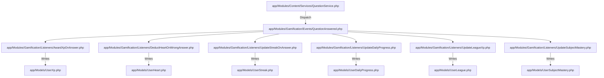
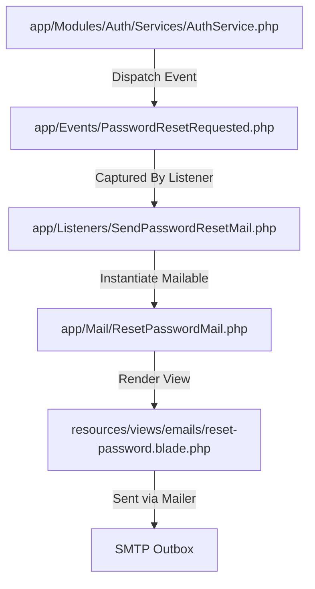

# Quizlo Backend Custom File Traverse Diagram

This document provides a detailed breakdown of the custom files we created (excluding standard Laravel framework boilerplate files) and explains how they interact with each other in the codebase during execution.

---

## 1. Directory Tree of Custom Files

This tree highlights the custom files and directories added to implement the Quizlo features.

```
quizlo_backend/
├── app/
│   ├── Events/                             # Custom app-wide events
│   │   ├── EmailVerificationRequested.php  # Dispatched on email verification requests
│   │   └── PasswordResetRequested.php      # Dispatched on password reset requests
│   ├── Http/
│   │   └── Middleware/                     # Custom application middlewares
│   │       ├── AdminOnly.php               # Restricts routes to is_admin = true
│   │       ├── EnsureUserEnrolledInExamType.php # Ensures user is enrolled before accessing content
│   │       └── EnsureUserHasHearts.php     # Rejects answer submission if user is out of hearts
│   ├── Listeners/                          # App-wide event listeners
│   │   ├── SendEmailVerificationMail.php   # Handles EmailVerificationRequested to send mail
│   │   └── SendPasswordResetMail.php       # Handles PasswordResetRequested to send mail
│   ├── Mail/                               # Custom Mailables for SMTP delivery
│   │   ├── ResetPasswordMail.php           # Formats password reset email with OTP
│   │   └── VerifyEmailMail.php             # Formats verification email with OTP
│   ├── Models/                             # Active Eloquent database models
│   │   ├── Achievement.php                 # Global achievement rewards
│   │   ├── CoinTransaction.php             # Coin log ledger
│   │   ├── EmailVerification.php           # Holds temp email OTP tokens
│   │   ├── ExamSchedule.php                # Mock exam schedules & dates
│   │   ├── ExamSession.php                 # An active exam session
│   │   ├── ExamType.php                    # Exam Categories (e.g. BCS Preliminary)
│   │   ├── ExamTypeSubject.php             # Scoped subject title mapping under ExamType
│   │   ├── ExamTypeSubjectPivot.php        # Pivot model mapping global subjects
│   │   ├── Lesson.php                      # Study topics under a subject
│   │   ├── ModelTest.php                   # Exam templates
│   │   ├── OtpVerification.php             # Holds phone login OTP tokens
│   │   ├── Question.php                    # Question bank resource
│   │   ├── QuestionOption.php              # Question multiple choice options
│   │   ├── Subject.php                     # Global subject names
│   │   ├── User.php                        # Main user profile (contains added casts/scopes)
│   │   ├── UserAchievement.php             # Earned user badge mapping
│   │   ├── UserAnswer.php                  # Individual answers submitted
│   │   ├── UserCoin.php                    # User coin wallet
│   │   ├── UserDailyProgress.php           # User daily quota target logs
│   │   ├── UserExamType.php                # User target exam enrollment mapping
│   │   ├── UserHeart.php                   # User hearts counter status
│   │   ├── UserLeague.php                  # Standing of a user in a league tier
│   │   ├── UserLessonCompletion.php        # Records completed lessons
│   │   ├── UserStreak.php                  # Streak days counter status
│   │   ├── UserSubjectMastery.php          # Subject-wise correctness stats
│   │   ├── UserXp.php                      # User accumulated XP weight
│   │   └── XpTransaction.php               # XP transaction history ledger
│   └── Modules/                            # Core Modular Domain Logic
│       ├── Admin/                          # Admin Management Subsystem
│       │   ├── Controllers/                # Controllers for admin control panel
│       │   │   ├── ContentManagementController.php # Questions & lessons management
│       │   │   ├── DashboardController.php # Admin dashboard stats & analytics
│       │   │   ├── ExamTypeManagementController.php # Exam categories CRUD & schedules
│       │   │   ├── ExamTypeSubjectManagementController.php # Exam subject mappings CRUD
│       │   │   ├── SubjectManagementController.php # Global subjects CRUD
│       │   │   └── UserManagementController.php # User list & status toggling
│       │   ├── Requests/                   # Validation rules for admin forms
│       │   │   ├── StoreExamTypeSubjectRequest.php
│       │   │   ├── StoreSubjectRequest.php
│       │   │   ├── UpdateExamTypeSubjectRequest.php
│       │   │   └── UpdateSubjectRequest.php
│       │   └── Routes/
│       │       └── api.php                 # /api/v1/admin/* route mappings
│       ├── Auth/                           # Authentication Subsystem
│       │   ├── Controllers/
│       │   │   ├── AuthController.php      # OTP/Email registration, verification, login
│       │   │   └── GoogleAuthController.php # Google Social login & callback handler
│       │   ├── Repositories/
│       │   │   ├── Contracts/
│       │   │   │   └── AuthRepositoryInterface.php
│       │   │   └── AuthRepository.php      # Data access layer for OTP/User creation
│       │   ├── Routes/
│       │   │   └── api.php                 # /api/v1/auth/* route mappings
│       │   └── Services/
│       │       ├── Contracts/
│       │       │   └── AuthServiceInterface.php
│       │       └── AuthService.php         # Password validation, registration, OTP checks
│       ├── Content/                        # Content Retriving Subsystem
│       │   ├── Controllers/
│       │   │   ├── LessonController.php
│       │   │   ├── QuestionController.php
│       │   │   └── SubjectController.php
│       │   ├── Routes/
│       │   │   └── api.php                 # /api/v1/{subjects,lessons,questions} routes
│       │   └── Services/
│       │       ├── LessonService.php
│       │       ├── QuestionService.php
│       │       └── SubjectService.php
│       ├── Exam/                           # Model Test Exam Subsystem
│       │   ├── Controllers/
│       │   │   ├── ExamSessionController.php
│       │   │   └── ModelTestController.php
│       │   ├── Routes/
│       │   │   └── api.php                 # /api/v1/{model-tests,exam-sessions} routes
│       │   └── Services/
│       │       └── ExamService.php         # Calculates exam session scores, start/stop timers
│       ├── ExamType/                       # Exam Category listing
│       │   ├── Controllers/
│       │   │   └── ExamTypeController.php
│       │   ├── Routes/
│       │   │   └── api.php                 # /api/v1/exam-types routes
│       │   └── Services/
│       │       └── ExamTypeService.php
│       ├── Gamification/                   # XP, Hearts, Coins, Streaks Subsystem
│       │   ├── Controllers/
│       │   │   ├── CoinController.php
│       │   │   ├── HeartController.php
│       │   │   ├── StreakController.php
│       │   │   └── XpController.php
│       │   ├── Events/                     # Subsystem events
│       │   │   ├── LessonCompleted.php
│       │   │   ├── QuestionAnswered.php
│       │   │   └── StreakMilestoneReached.php
│       │   ├── Listeners/                  # Responds to user actions to update stats
│       │   │   ├── AwardCoinOnLessonComplete.php
│       │   │   ├── AwardXpOnAnswer.php
│       │   │   ├── DeductHeartOnWrongAnswer.php
│       │   │   ├── UpdateDailyProgress.php
│       │   │   ├── UpdateLeagueXp.php
│       │   │   ├── UpdateStreakOnAnswer.php
│       │   │   └── UpdateSubjectMastery.php
│       │   ├── Routes/
│       │   │   └── api.php                 # /api/v1/gamification/* routes
│       │   └── Services/
│       │       ├── CoinService.php
│       │       ├── HeartService.php
│       │       ├── StreakService.php
│       │       └── XpService.php
│       └── League/                          # Division Leagues Standings
│           ├── Controllers/
│           │   └── LeagueController.php
│           ├── Routes/
│           │   └── api.php                 # /api/v1/league/* routes
│           └── Services/
│               └── LeagueService.php       # League standing rank sorting
├── resources/
│   └── views/
│       └── emails/                         # Email HTML blade templates
│           ├── reset-password.blade.php
│           └── verify-email.blade.php
├── supervisord.conf                        # Background worker configurations
└── railpack.json                           # Deploy configurations
```

---

## 2. File Traverse Flows

The diagrams below demonstrate how execution control traverses through different custom files depending on the type of operation.

### A. Route Execution & Request Validation Traverse
When a request is received, it traverses from routes to validation, then service logic and DB:

```mermaid
graph LR
    routes["routes/api.php"] -->|Include Modules| module_routes["app/Modules/*/Routes/api.php"]
    module_routes -->|Call Controller Method| controller["app/Modules/*/Controllers/*Controller.php"]
    
    controller -->|Inject Validator| request["app/Modules/*/Requests/*Request.php"]
    request -->|Input Validated| service["app/Modules/*/Services/*Service.php"]
    
    service -->|Read/Write Data| model["app/Models/*.php"]
```



### B. Event Listeners & Side-Effect Traverse
When a user finishes an action, events are dispatched and caught by listeners to update different parts of the system:



### C. Email Dispatch Traverse
When a user requests a password reset or email verification, the request triggers an event which spawns an email class and uses a Blade layout to send the mail:


